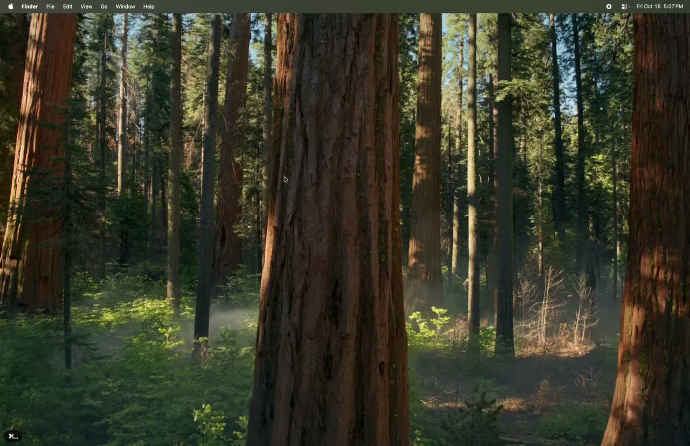

# wayshare

Share your Hyprland desktop with a Mac, using the Screen Sharing app it already has.
wayshare speaks Apple's Screen Sharing protocol, so there's nothing to install on the Mac.

- The Mac's ⌘ key sends Super, so your Hyprland and Omarchy shortcuts work as usual.
- Copy and paste text, rich text and images in both directions.
- Screen Sharing's High Performance mode works, for sharp, low-latency video and sound.

[](docs/media/demo.mp4)

*Demo (40s): click to watch.*

Needs Hyprland 0.56 or newer and systemd.

## Install

```sh
curl -fsSL https://raw.githubusercontent.com/wesleygrimes/wayshare/main/install.sh | sh
```

This puts `wayshare` in `~/.local/bin` and sets up its systemd user service, without sudo.
Builds are for x86_64 and ARM64.

Other ways to install:

- With [mise](https://mise.jdx.dev): `mise use -g github:wesleygrimes/wayshare`, then
  `wayshare install-service`
- [From source](docs/development.md#installing-from-source)

wayshare isn't on the AUR or in `omarchy pkg` yet. Those packages are coming soon.

## Set up

1. Pick a password. Screen Sharing asks for this user name and password when you connect.

   ```sh
   wayshare set-password --user "$USER"
   ```

2. Tell wayshare which monitor to share. `hyprctl monitors` lists them; replace `DP-1` with
   yours.

   ```sh
   mkdir -p ~/.config/wayshare
   echo 'output = "DP-1"' > ~/.config/wayshare/config.toml
   ```

3. Start it with your session:

   ```sh
   systemctl --user enable --now wayshare
   ```

   On Omarchy that's all. Elsewhere, if wayshare doesn't come back after you log in again,
   add [one line to `hyprland.conf`](docs/troubleshooting.md#the-service-doesnt-start-at-login).

4. On the Mac, open the **Screen Sharing** app (search for it with Spotlight), choose
   **Connection > New** and enter the Linux machine's address, like `192.168.1.20`. Sign in
   with the password from step 1. To get sharper, low-latency video and sound, pick
   **High Performance** when it asks (see [High Performance mode](docs/high-performance.md)).

   The machine also shows up in Finder's sidebar under **Network**.

Connection trouble? See [Troubleshooting](docs/troubleshooting.md).

## Upgrade

Run the install command again. It restarts the service for you.

With mise or a package, upgrade the usual way, then restart the service:

```sh
systemctl --user restart wayshare
```

## Uninstall

```sh
systemctl --user disable --now wayshare
rm -f ~/.local/bin/wayshare ~/.local/share/systemd/user/wayshare.service
```

If you installed with mise or a package, remove it that way too. Your password and settings
stay in your config directory (usually `~/.config/wayshare`) until you delete it.

## More

- [Configuration](docs/configuration.md): every setting, keyboard mapping, the sidebar name
- [High Performance mode](docs/high-performance.md): what it needs, encoders, audio
- [Firewall](docs/firewall.md): which ports to open
- [Troubleshooting](docs/troubleshooting.md): logs and the usual problems
- [Packaging](docs/packaging.md): install layout and dependencies, for distro packagers
- [Development](docs/development.md): building, tests, live checks

## Support

wayshare is free. If it's useful, you can [sponsor the work](https://github.com/sponsors/wesleygrimes) or [buy me a coffee](https://buymeacoffee.com/ncfrontiersman).

## License

Apache-2.0. See [LICENSE](LICENSE).
